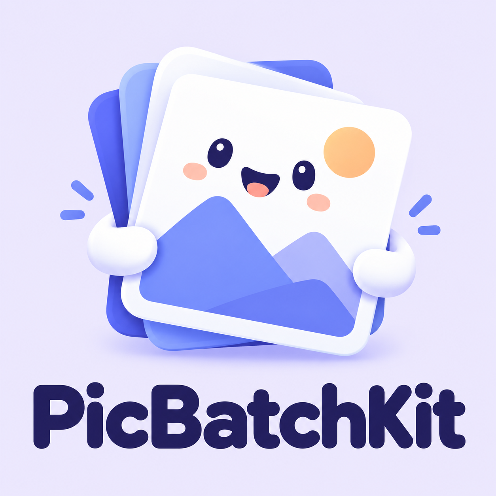
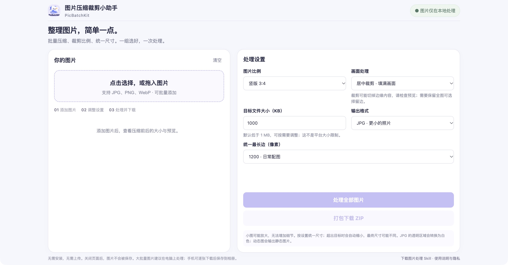

# 图片压缩裁剪小助手 · PicBatchKit

**[👉 打开网页版，无需下载或安装](https://dimoo-rich.github.io/PicBatchKit/)** · [版本与下载](https://github.com/Dimoo-rich/PicBatchKit/releases)

批量压缩图片、裁剪比例、统一尺寸。适合头像上传、附件大小限制和整组配图整理。

## 选择适合你的版本

| 版本 | 适合场景 | 使用方式与区别 |
| --- | --- | --- |
| 电脑网页版 | 批量整理、编号、打包图片 | 直接打开上方链接；支持调整顺序、按顺序编号、逐张下载或 ZIP 打包，ZIP 内附处理报告 |
| 小红书小工具版 | 手机随手处理配图 | 从挂载了工具的笔记进入「图片压缩裁剪小助手」；处理后保存到相册，每次最多 9 张、单张不超过 20 MB；不提供 ZIP 下载 |
| Codex Skill | 用自然语言处理本地图片或文件夹 | 下载 Skill 包后安装；由 Python 和 Pillow 在本地执行，不是手机 App |

## 主要功能

- 批量处理 JPG、PNG、WebP，选择输出格式和目标文件大小。
- 裁剪为 3:4、1:1，或保留原比例；也可使用白色留边保留完整画面。
- 统一最长边，查看处理后的图片预览、大小和尺寸。
- 网页版可调整顺序，按 01、02 等编号下载，并打包 ZIP。
- 图片压缩和裁剪在用户设备上完成，工具不向服务器上传图片内容。

## 网页版使用

[打开网页版](https://dimoo-rich.github.io/PicBatchKit/) → 添加图片 → 选择设置 → 处理全部图片 → 检查预览 → 下载。

桌面端采用左右等高布局，设置双列排列。常规桌面窗口可一屏操作，多张图片在左侧列表内滚动；较窄或较矮的窗口会按可用空间调整。

离线使用：从 [Releases](https://github.com/Dimoo-rich/PicBatchKit/releases) 下载网页版 ZIP，解压后用现代浏览器打开 `index.html`。无需构建或安装依赖。也可将仓库根目录部署到静态托管服务。

## Skill 使用

从 [Releases](https://github.com/Dimoo-rich/PicBatchKit/releases) 或本仓库下载 `image-compressor-skill.zip`，解压后将 `image-compressor` 文件夹放到自己的 `~/.codex/skills/` 目录。需要 Python 3 和 Pillow，依赖与详细参数见包内 `requirements.txt` 和 `SKILL.md`。

示例：

> 使用 $image-compressor 把这些图片整理成 3:4 配图，每张小于 1 MB，按顺序打包，保留原文件。

## 隐私与使用提醒

- 图片在设备端处理，不上传服务器；访问在线网页本身仍会经过托管服务，可能产生访问日志。本地处理减少了上传环节的隐私风险，不代表绝对安全。
- 默认 1200 像素和 1000 KB 是工具预设，不是平台上传限制。
- 居中裁剪可能切掉边缘内容；请检查预览，需要保留全图可选择留边。小图放大不会增加细节。
- 为达到文件大小目标，工具可能进一步缩小尺寸。PNG 不一定比原图更小；透明图片转 JPG 会变成白底，动态图输出静态图片，HEIC 不支持。
- 小红书版保存需要相册权限，保存后的图片顺序由系统决定，发布时请检查。网页版手机端下载行为取决于浏览器，尚未覆盖所有设备。
- 本项目与小红书无隶属关系。

## 验证范围

已验证网页批量 3:4 输出、ZIP 文件内容与完整性，以及 Skill 的裁剪、留边、体积上限、编号、坏图隔离和原文件保留。新版桌面布局已进行浏览器目视检查，图片处理 JavaScript 与之前版本一致。小红书版完成模拟器处理与保存验证，并收到用户手机实测正常的反馈；未声称覆盖全部机型。

## 源码与许可

源码已公开，**目前尚未选择开源许可证**。公开源码不等于已授予修改、再分发或商用许可。后续确定许可证时会在仓库中明确说明。
